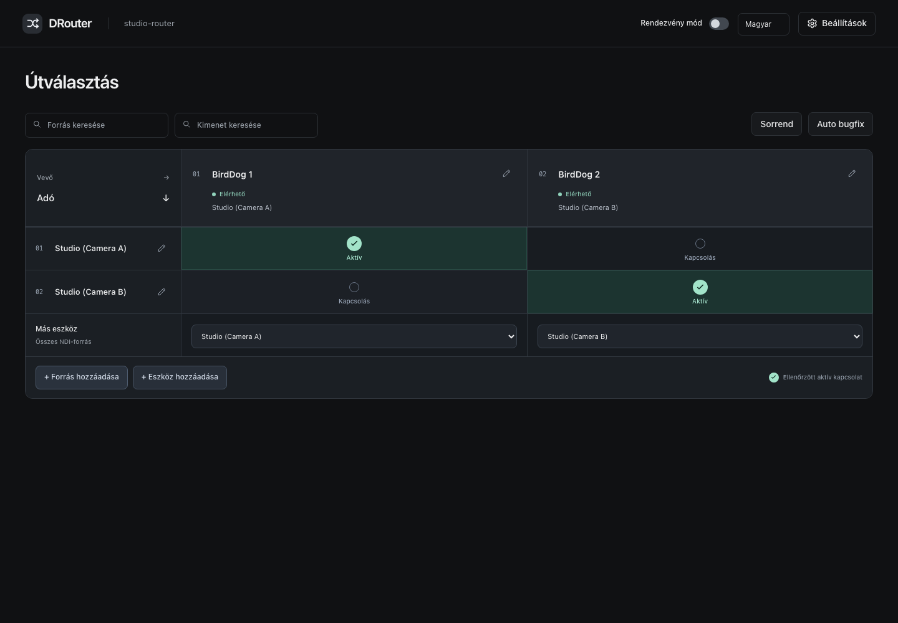

# DRouter

Standalone Rust NDI routing controller for the **Waveshare ESP32-S3-ETH, SKU 28972**, with an optional Cloudflare remote relay. The ESP32 owns its configuration, password verifier, Wi-Fi credentials, receivers and presets. It controls BirdDog decoders; it never carries NDI video.

The macOS simulator runs the same authentication, validation, routing, preset, Wi-Fi selection and configuration core as the firmware. Its two virtual BirdDog HTTP servers implement mutable decoder state, configurable source lists, unavailable devices, ignored switches and request delays. The Cloudflare Worker is a real Wrangler Durable Object service, not a simulated HTTP relay.



Latest release: [v0.2.4](https://github.com/DezBenedek/drouter/releases/tag/v0.2.4) · [ESP32-S3 firmware image](https://github.com/DezBenedek/drouter/releases/download/v0.2.4/drouter-esp32s3.bin) · [SHA256SUMS](https://github.com/DezBenedek/drouter/releases/download/v0.2.4/SHA256SUMS).

## Repository

| Directory | Purpose |
| --- | --- |
| `firmware/` | Shared Rust device core, ESP-IDF hardware integration, compressed vanilla HTML/CSS/JS local UI |
| `cloud/` | Worker, hibernating Durable Object relay, React/TypeScript remote interface, relay/browser integration tests |
| `protocol/` | JSON schema, protocol/security specification, shared native/WASM SRP implementation |
| `simulator/` | Native Rust server, encrypted file storage, virtual BirdDog HTTP devices and network fault controls |
| `scripts/` | Asset regeneration, test runner, firmware image helpers |
| `docs/` | Hardware acceptance plan, implementation details, captured browser screenshots |

## Quick start on macOS

Install [Rust with rustup](https://rustup.rs/) and Node.js 22.12 or newer. The checked-in WASM and compressed local assets let you build the simulator and cloud without installing the ESP toolchain or regenerating assets. The tested native Rust version is 1.96.1; ESP builds use the separate `esp` toolchain.

From the repository root:

```sh
npm ci --prefix cloud
cargo build -p drouter-simulator
cargo run -p drouter-simulator
```

Open **http://127.0.0.1:8080**. Choose a device name and an administrator password of at least 4 Unicode characters. Ethernet defaults to DHCP; Wi-Fi and Cloud access are optional. There is no default administrator password. Use **+ Add device → Discover receivers** to register both virtual receivers, then **+ Add source** to save sources in the routing matrix. The simulator binds loopback only.

State is saved under `.drouter-state/` using AES-256-GCM. The directory is mode 0700 and its encryption key/files are mode 0600. Keep the complete directory, including its key, when backing up. Only one simulator can use a state directory at a time. Virtual receiver state belongs to the receiver processes and resets on restart; DRouter presets and configuration persist. Boot reads the actual current routes and does not apply a preset.

To use another simulator state directory or HTTP port:

```sh
DROUTER_STATE=/tmp/drouter-development DROUTER_PORT=8081 cargo run -p drouter-simulator
```

The virtual receiver ports default to 9001 and 9002. Set `DROUTER_BIRDDOG_PORT_BASE=19001` together with a separate HTTP port/state directory to run another isolated simulator.

## Local Cloudflare development

In a second terminal:

```sh
npm run build --prefix cloud
npm run dev --prefix cloud
```

This starts the real Worker, static React assets and Durable Object at **http://127.0.0.1:8787**. No domain, Cloudflare account, API token, D1, KV or R2 is needed for local development.

In the local device UI, open **Settings → Remote Access → Advanced · custom server**, set `http://127.0.0.1:8787`, then enable remote access. Reconnect locally after session revocation. The simulator connects automatically. Enter the ordinary device name, such as `studio-router`, and administrator password at **http://127.0.0.1:8787**. Wrangler keeps local name reservations in `.wrangler/state`; keep this directory to preserve the development registry.

For React hot reload, leave Wrangler running and start:

```sh
npm run ui --prefix cloud
```

Open **http://127.0.0.1:5173**. Vite proxies relay WebSockets to Wrangler. The development Origin exception is restricted to loopback. Production defaults to `https://drouter.dezso.hu`; ordinary users do not enter a server URL. Only the simulator accepts loopback HTTP overrides. The ESP32 requires HTTPS, verified certificates and valid system time.

## Identity, passwords and recovery

Device names use 3–32 lowercase ASCII letters, digits, and single hyphens. Remote login requires only this name and the device password. An immutable device ID is the SHA-256 digest of its Ed25519 public key. The private key stays in encrypted device configuration.

A separate SQLite Durable Object reserves each name permanently to its device ID/public key, even while offline. Registration and reconnection require a fresh, signed challenge covering the identity and requested name. Renaming preserves the ID and reserves the previous name as an alias; another identity cannot claim either name. Remote Access settings distinguish occupied names, an identity already running in another instance, rejected identities, and temporary registration-service failures. Network/storage failures do not mean the name is taken. Retries are automatic, and changing the name/server/access setting interrupts retry backoff within one second. Local setup and routing still work if reservation is unavailable.

Before resetting or replacing a device, use **local Settings → Security card → Export recovery file**. Keep that private file offline and secure: it proves ownership of your names. After provisioning a replacement, use **Restore identity**, supply the file and reserved name, and create a new password. Recovery never uses a cloud password database. Without the original private identity or a recovery file, reserved names cannot be reclaimed; choose a new name. Factory reset cannot release or transfer a reservation. Schema-one configurations migrate in place without replacing their identity, verifier, Wi-Fi order, receivers, or presets.

The browser authenticates directly to the device using the same RustCrypto SRP implementation on both sides. Password hardening uses PBKDF2-HMAC-SHA256; the device stores only salt and SRP verifier. Application commands and responses use directional AES-GCM keys derived from the SRP session. Cloudflare sees neither passwords, verifiers nor plaintext configuration updates. The live encryption key stays in memory. A rotating six-hour resume credential is stored in sessionStorage for the current tab; language preferences use localStorage; cloud SQLite contains the minimal public identity registry. See [the full protocol and trust boundary](protocol/README.md).

Sessions expire after 24 hours while the interface remains open. Reloading the same tab restores the administrator or Simple Mode session for up to six hours after the original login, without saving the password or live RPC key. Resume credentials rotate on use and do not extend the original six-hour deadline. Closing the tab clears its sessionStorage. A device restart, expired/revoked credential or lost device connection requires a fresh login. Wi-Fi/security/settings access remains authorized for six hours after login, so settings changes do not require a new login after five minutes. After six hours, reconnect to authorize further settings changes; ordinary routing remains available within the 24-hour session. **Revoke all sessions** works locally and remotely. Changing the password or disabling Cloud access revokes sessions. A lost administrator password requires physical factory reset, which erases user data; the relay cannot reset it while retaining access.

## Interface

The interface has one dark routing screen on desktop and mobile. Transmitters are rows and receivers are columns; **+ Add source** and **+ Add device** sit below the table. Pencil buttons open modal editors, and **Reorder** reveals arrow controls for both axes. Receiver order is saved on the device. The final **Other device** row offers a dropdown containing every discovered NDI source for each receiver without saving the selected source. The matrix uses full-cell switch targets, a checked active state, pinned source labels and receiver headers. Mobile receiver tabs show one column at a time, so routing fits the screen without sideways scrolling; the selected receiver survives filtering and settings dialogs. A route becomes active only after receiver readback confirms it.

The header contains **Event Mode**, the English/Hungarian language switch, and **Settings**. Settings opens a wide dialog with a sidebar for Simple Mode, device, network, remote access, security and system sections. Each Simple Mode has an enable switch in Settings. Its modal editor asks only for a separate password and up to ten fixed buttons: **Name · Device · NDI source**. New profiles are named automatically from their first button. Each row creates one fixed routing button. Profile passwords and existing mappings are preserved when editing.

A fixed status line above the interface shows the current operation, progress and detail, including **Auto bugfix (2/21)**. Its log contains the last 30 activity messages for the current page session. Dialogs repeat the current activity above their content.

The **NDI list reset** button in the final **Other device** row runs BirdDog's `/reset` on each configured receiver and then reads `/List`: unlike `/refresh`, reset removes cached inactive sources and finds the active ones ([BirdDog API](https://birddog.tv/AV/API/)). Saved DRouter sources and mappings are preserved.

**Auto bugfix** runs on both the administrator screen and the restricted Simple Mode screen. Each receiver has six separate, bounded steps: retry connection/current-route reads, inspect the cached source list, refresh discovery with retry, reset stale finder entries, restore the captured source with retry/readback, and verify the final route. The status line reports the actual step, device and total progress; the activity log includes recovered faults and remaining errors. Unsupported reset falls back to refresh plus verified restoration. Offline devices, unavailable original sources and failed final verification are reported as failures while other receivers continue. Restricted sessions can repair only their profile's receivers and currently assigned sources; permissions and Event Mode are checked on every step. Repairs are bound to the login session, expire, and are cancelled by newer routing commands. No arbitrary replacement source, reboot or configuration write is performed. Notifications remain visible over modal dialogs, can be dismissed and pause expiry while hovered or focused.

Source selection tolerates transient list/readback failures, lost command replies and delayed decoder application. Switching takes priority over queued polling reads without overlapping encrypted requests. An open native source picker keeps its options/selection during polling. A failed background discovery retains known choices; a transient offline read still permits retrying a saved or known source. Slow full-list refreshes no longer hold the matrix busy after a verified switch.

Both interfaces share locally bundled [Oat UI](https://oat.ink/) 1.0.0, neutral surfaces and system fonts. The ESP32 runs vanilla JavaScript; React remains exclusive to the Cloudflare interface. Sonner runs only in the cloud React interface; the embedded controller stays framework-free, and axe is a development dependency; no runtime CDN requests are needed. Edit `scripts/design.css` for the design system and run `npm run build:css --prefix cloud`. Run `node scripts/pack-web.mjs` to regenerate minified/gzipped local assets without rebuilding authentication WASM. Ordinary cloud builds regenerate the stylesheet automatically. See [the audit and acceptance evidence](docs/ui/overhaul.md).

No provisioning token is required. First boot is a five-step setup wizard: welcome, name/password, Ethernet/optional Wi-Fi profiles, optional remote access, and completion. Remote registration failure never blocks local setup.

## Tests

If another simulator is running, use `DROUTER_TEST_PORT_OFFSET=10000 ./scripts/test.sh` to test on separate ports without stopping it.

Install Chromium once:

```sh
cd cloud
npx playwright install chromium
cd ..
```

Run all host checks, Worker tests, build and end-to-end Chromium tests:

```sh
./scripts/test.sh
```

Or run them separately:

```sh
cargo test --workspace
cargo build -p drouter-simulator
npm test --prefix cloud
npm run build --prefix cloud
npm run test:e2e --prefix cloud
```

For the session-reload regression suite, run `DROUTER_TEST_PORT_OFFSET=20000 DROUTER_TEST_RELOAD_ONLY=1 npm run test:e2e --prefix cloud`. It checks administrator and restricted reloads locally and through the relay, interrupted requests, credential rotation, expiry and acknowledged logout.

The integration runner starts and stops its own simulator and Wrangler processes, provisions a fresh temporary device, and exercises real HTTP BirdDog devices through the real relay. Ports **8080, 8787, 9001 and 9002 must be free**. It tests local and remote routing, wrong passwords, unauthorized commands, identity collisions and spoofing, source-switch verification, partial preset failures, request deadlines, Wi-Fi reordering/redaction, Ethernet failures, Cloud outage/reconnect, restart persistence, invalid JSON, oversized requests and local session revocation. Chromium also logs in to both interfaces, changes real virtual-decoder state, checks mobile overflow and captures screenshots. Native tests cover replay, expiration, pending/authentication limits, Wi-Fi fallback/preferred-network hysteresis, storage rollback and interrupted-write recovery.

## Simulator fault injection

Fault control is disabled unless you explicitly supply a secret of at least 16 characters. It is a simulator-only endpoint, separate from the production application protocol.

```sh
DROUTER_SIM_CONTROL=development-control-token cargo run -p drouter-simulator
```

Example requests:

```sh
curl http://127.0.0.1:8080/sim/faults \
  -H 'Content-Type: application/json' \
  -H 'x-simulator-token: development-control-token' \
  -d '{"receiver":0,"ignore_switch":true}'

curl http://127.0.0.1:8080/sim/faults \
  -H 'Content-Type: application/json' \
  -H 'x-simulator-token: development-control-token' \
  -d '{"cloud":false,"ethernet":false,"wifi":["Backup-Hotspot"]}'
```

Supported fields: `cloud`, `ethernet`, available `wifi` SSIDs; receiver index `receiver` with `online`, `ignore_switch`, `delay_ms` (maximum 10 seconds), or `sources` (up to 64 names). Switch failures and timeouts are real failed HTTP/readback operations, not preprogrammed successful responses. Restore `cloud:true` and `ethernet:true` independently.

Saved WPA2-Personal networks are tried in priority order, skipping disabled profiles. There is no fixed profile-count cap; the shared 24 KiB configuration budget and 13,000-byte redacted Wi-Fi-list budget are enforced before saving, so every saved profile remains manageable through the bounded protocol. Add, edit, enable, disable, remove, reconnect, and reorder networks locally or remotely. Blank edit passwords preserve the existing secret. Remote removal, disabling, or credential changes to the active Wi-Fi profile require explicit disconnect acknowledgement if Ethernet is unavailable; the physical BOOT recovery AP remains available. An absent network falls back to the next visible profile. The preferred-network check defaults to 300 seconds; two consecutive preferred scans and a minimum dwell period prevent oscillation. Retry and preferred-network policy can be changed in Settings. Credentials are never returned in `wifi.list`. WPA-Enterprise is not implemented.

## ESP32-S3 firmware build on macOS

Install Xcode command-line tools if needed (`xcode-select --install`), Homebrew Python/CMake/Ninja, and the supported ESP Rust tools:

```sh
brew install python cmake ninja
cargo install espup --locked
cargo install ldproxy --locked
cargo install espflash --locked
espup install --targets esp32s3 --export-file "$PWD/export-esp.sh"
. ./export-esp.sh
cd firmware
cargo +esp build --features esp --release
cd ..
```

Run the `cargo +esp` command **inside `firmware/`** so its `.cargo/config.toml` supplies the Xtensa target, linker and partition-table copy configuration. The target is **`xtensa-esp32s3-espidf`**. ESP-IDF is pinned to **v5.4.2**, `esp-idf-svc` to its locked 0.52 release, and `esp_websocket_client` to 1.4.0. The first build downloads ESP-IDF and managed C/Python dependencies into `.embuild/`; allow several GB of disk space. Do not put an activated Python virtualenv first on PATH when building: ESP-IDF creates its own Python environment. Re-source `export-esp.sh` in each new shell.

Firmware assets are embedded at compile time. Ordinary firmware builds need no npm/React build. If you change the shared SRP client or local assets, regenerate first:

```sh
rustup target add wasm32-unknown-unknown
cargo install wasm-bindgen-cli --version 0.2.129 --locked
npm ci --prefix cloud
./scripts/build-web.sh
```

The wasm-bindgen CLI version must match `Cargo.lock`. `WASM_BINDGEN=/absolute/path/to/wasm-bindgen ./scripts/build-web.sh` selects an existing binary. Regeneration minifies the generated binding/crypto module and gzip-compresses every served local asset.

### Flashing and serial logs

Connect the board's USB-C data port. List available ports:

```sh
espflash list-ports
```

Use your actual `/dev/cu.usbmodem…` path. From the repository root:

```sh
espflash flash \
  --chip esp32s3 \
  --port /dev/cu.usbmodemYOURPORT \
  --flash-size 16mb \
  --partition-table firmware/partitions.csv \
  --bootloader target/xtensa-esp32s3-espidf/release/bootloader.bin \
  --monitor \
  target/xtensa-esp32s3-espidf/release/drouter-firmware
```

The custom ESP-IDF bootloader is required for the selected PSRAM/flash/NVS configuration. If automatic USB reset does not enter the bootloader, hold BOOT, press RESET, then release BOOT and retry. Open logs without reflashing:

```sh
espflash monitor --port /dev/cu.usbmodemYOURPORT
```

First boot prints the unique WPA2 setup AP SSID/password over USB. Join `DRouter-Setup-XXXX`, open `http://192.168.4.1`, and complete setup. AP credentials are generated securely per boot and are not uploaded. The early boot entropy source is explicitly enabled for provisioning/key generation, then disabled before Wi-Fi starts; runtime randomness uses the active Wi-Fi subsystem. The configured-device recovery flow uses the onboard BOOT button to disclose the current recovery AP credentials over USB after a three-second hold. A 12-second hold resets configuration. Boot configuration corruption never silently erases user data; USB erase remains available.

**Erasing configuration is destructive.** With the board connected, this explicitly removes the configuration partition and generates a new device identity on setup:

```sh
espflash erase-parts --port /dev/cu.usbmodemYOURPORT config
```

To return every partition to blank flash, `espflash erase-flash --port /dev/cu.usbmodemYOURPORT` erases the firmware and all keys; flash again afterward. Neither operation has been run without the physical board.

### Hardware configuration

| W5500 signal | GPIO |
| --- | --- |
| MISO | 12 |
| MOSI | 11 |
| SCLK | 13 |
| CS | 14 |
| Reset | 9 |
| Interrupt | 10 |
| Status LED (WS2812) | 21 |

These assignments come from the [official Waveshare board documentation](https://docs.waveshare.com/ESP32-S3-ETH/Development-Environment-Setup-ESP-IDF). SPI2 runs at 20 MHz with DMA. No flash/PSRAM pins are repurposed. Wi-Fi and Ethernet coexist; Wi-Fi's default-route priority is higher for internet access, while connected Ethernet subnets carry BirdDog traffic. Use distinct, non-overlapping subnets when both interfaces are active.

The 16 MB partition layout reserves encrypted NVS configuration, an NVS key partition, OTA metadata and two 7 MiB application slots. It needs no microSD. OTA slots are reserved for future updates; no OTA updater is advertised. Configuration uses two revisioned, checksummed NVS blobs and avoids writes when values are unchanged. Wi-Fi driver persistence is disabled; saved profiles live in encrypted configuration. NVS encryption protects credential blobs, but development NVS keys are not protected against a physical flash dump until a reviewed flash-encryption/secure-boot provisioning process is applied. This project does not burn irreversible security eFuses automatically.

## BirdDog compatibility

The adapter implements the documented [BirdDog API 2.0](https://birddog.tv/AV/API/) endpoints `/about`, `/List`, `/connectTo` and `/refresh`, normally on port 8080. The source list accepts the documented object form and a bounded array variant. Switching sends the documented `sourceName` POST and verifies `/connectTo` readback with bounded retries. Devices that do not identify as BirdDog or do not provide decoder readback are rejected.

API 1.0 is deliberately not claimed. Automatic discovery of physical BirdDog devices is not claimed because a verified universal receiver-discovery service was not established from the API reference. Manual private IPv4 registration is implemented; simulator discovery verifies the two known virtual endpoints through the same adapter. Specific models/firmware versions still require interoperability checks against real devices; the vendor documentation is inconsistent in some response details. See [hardware acceptance](docs/HARDWARE-ACCEPTANCE.md).

## Deployment

Local development does not deploy anything. To deploy the already reviewed cloud build to your own Cloudflare account:

```sh
cd cloud
npx wrangler login
npm run deploy
```

This creates one Worker, the live relay class, and the separate SQLite registry class using the additive `v2-registry` migration. Preserve the existing `v1` migration on upgrades. The operator needs a Cloudflare account; end users do not. Use the Worker hostname as a local device advanced override during self-hosted testing. The production address is `https://drouter.dezso.hu`. The checked-in Worker route binds `drouter.dezso.hu/*` to DRouter through the existing `okosurlap.hu` Cloudflare for SaaS zone; its external CNAME points to `customers.okosurlap.hu`. Preserve this route and the existing custom-hostname/TLS setup on deployment; `dezso.hu` does not need to move DNS providers.

The production interface is **https://drouter.dezso.hu**; **https://drouter.dezbenedek.workers.dev** remains a compatible alternate origin. A simulator running on localhost can connect directly to this public relay through outbound WSS; no router port forwarding or tunnel is required. In **local Settings → Remote Access → Advanced · custom server**, set this HTTPS origin, enable remote access and reconnect after authentication is renewed. Open the public Worker URL for remote control using the local device's name and password. The Mac and simulator must remain running. The default device server already uses `https://drouter.dezso.hu`; no advanced override is needed for production.

An explicit live verification command is available after building the simulator:

```sh
cd cloud
DROUTER_LIVE_ORIGIN=https://drouter.dezso.hu node tests/live-relay-check.mjs
```

This uses an isolated temporary simulator on ports 18081/19011/19012 and verifies real public-relay administrator/Simple Mode login, fixed BirdDog routing, Event Mode, and the mobile browser interface. It leaves only a randomly named minimal `deploy-check-*` device registration in the production registry, as permanent name reservation requires; temporary local credentials/state and processes are removed. It does not change the existing local device configuration. This command is deliberately separate from the ordinary integration suite.

There are no mandatory D1, KV, R2 or account bindings, no cron triggers and no persistent monitoring. The registry stores only names, immutable IDs, public keys, and registration/rename/hourly connection timestamps. Presence is derived from live sockets. Worker observability is disabled in configuration; avoid enabling request-body/WebSocket logging. Hibernation attachments and cleanup alarms contain only transient authentication/connection bookkeeping. No password, verifier, local administrator session, configuration, receiver/source list, preset, or routing history is written to cloud storage.

## Verification boundary

See [the recorded software verification results](docs/VERIFICATION.md) for toolchain versions and the executed checks. `./scripts/firmware-image.sh` reproduces the merged flash image after a successful firmware build.

Software tests, browser screenshots and a firmware cross-build can establish implementation behavior before hardware arrives. They cannot establish electrical behavior, PSRAM stability, power-loss resilience on real flash, Wi-Fi roaming timing, physical Ethernet throughput, BirdDog model compatibility or 24/7 stability. The exact remaining measurements and soak tests are listed in [HARDWARE-ACCEPTANCE.md](docs/HARDWARE-ACCEPTANCE.md). Treat this as an implemented, testable initial release pending that acceptance, not a physically verified production appliance.


## Sources, Simple Mode and Event Mode

Use **+ Add source** to save discovered NDI sources and assign display names. Pencil buttons open rename/remove dialogs, and **Reorder** reveals ordering arrows. Cancelling an editor leaves persistent configuration unchanged. Saved sources survive temporary network absence and device restart. The desktop routing matrix has source rows and output columns. Its last row is **Other device**, with a separate dropdown containing every discovered NDI source for each output. Selecting an unsaved source routes it immediately without saving it. Mobile receiver tabs display one receiver column at a time with the same source rows.

Administrators can create up to eight **Simple Modes**, each with a distinct password and 1–10 fixed action buttons. Create/edit the profile, set each button's output and source, and confirm the displayed mappings before saving. Each profile opens its own restricted interface when its password is entered on the normal login page. Users can press the configured buttons and log out; the ESP32 rejects administrator API requests from those sessions. Passwords require 4–128 Unicode scalar values; short passwords are weak and longer passwords are recommended. See the [counting rule and authentication restrictions](protocol/README.md#modification-3-access-control-and-configuration).

**Event Mode** and language selection are in the main header. Event Mode requires administrator confirmation and temporarily locks every Simple Mode locally and remotely. It persists across device restarts, preserves profile configuration and changes no routing when disabled. Administrator routing remains available throughout. English and Hungarian are available on login, setup and the application; preference is remembered in the browser. Motion respects the operating system's reduced-motion preference.
